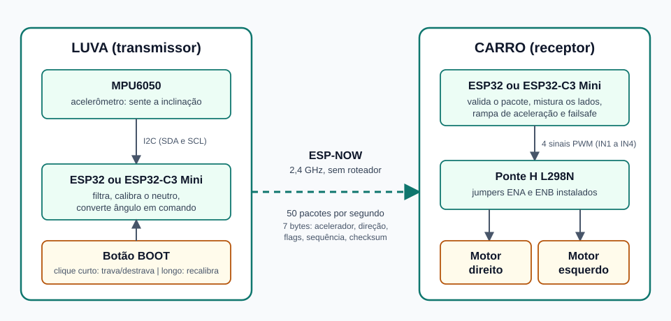

# ESP HAND CONTROL 2.0

Uma luva que lê a inclinação da mão e comanda um carrinho pelo ar, usando duas placas ESP32 e o protocolo ESP-NOW. Sem roteador, sem celular, sem internet.

Projeto do **Tio Rafa**  Versão 2.0 funciona com **ESP32 clássico** e **ESP32-C3 Mini**, nos cores Arduino-ESP32 2.x e 3.x.



**Kit na Mamute Eletrônica:** [Kit Projeto Esp-Hand Control - Prof. Rafael Oliveira](https://www.mamuteeletronica.com.br/kit-projeto-esp-hand-control-prof-rafael-oliveira-21010). Veja o conteúdo e a placa incluída na página da loja.

## Comece por aqui

1. Leia o [manual completo](docs/MANUAL.md).
2. Monte conforme a [pinagem](docs/PINAGEM.md) e a [lista de materiais](hardware/LISTA_DE_MATERIAIS.md).
3. Grave os sketches na ordem:

| Passo | Pasta | O que faz |
|---:|---|---|
| 1 | `firmware/Passo1_Descobrir_MAC` | Mostra o MAC do carro |
| 2 | `firmware/Passo2_Teste_MPU6050` | Testa o sensor |
| 3 | `firmware/Passo3_Teste_Motores` | Testa os motores (rodas no ar) |
| 4 | `firmware/Passo4_Carro_Receptor` | Firmware do carro |
| 5 | `firmware/Passo5_Luva_Transmissor` | Firmware da luva |

Antes do Passo 5, cole o MAC do carro em `config_luva.h` (`MAC_CARRO`). Com zeros, a luva se recusa a iniciar, de propósito.

## Segurança por projeto

- A luva inicia **travada**; o clique do botão trava e destrava.
- O carro para se ficar 400 ms sem pacote válido.
- Pacotes são validados (marcador, versão, checksum, faixa).
- Primeiro teste sempre com as rodas no ar.

## Estado de validação

| Etapa | Situação |
|---|---|
| Revisão e testes de lógica no computador (com simulação das bibliotecas do ESP32) | VALIDADO POR ANÁLISE |
| Compilação, gravação e funcionamento em placas reais | TESTADO EM HARDWARE pelo autor (Rafael Oliveira, informado em 04/11/2026) |
|  


## Estrutura

```text
firmware/   sketches e arquivos comuns (comum/ é a fonte oficial)
docs/       manual, protocolo, pinagem e imagens
hardware/   lista de materiais
tools/      sincronizar_comum.sh e testes no computador
```

Ao editar algo em `firmware/comum/`, rode `bash tools/sincronizar_comum.sh` para copiar aos sketches (`--checar` só verifica).


## Licença

Código sob licença MIT (arquivo `LICENSE`). Sugestão para os textos do manual: CC BY 4.0; decida antes de publicar.

## Contato

contato@tiorafa.tec.br | Instagram @prof.tiorafa | GitHub Tio-Rafa-SE
