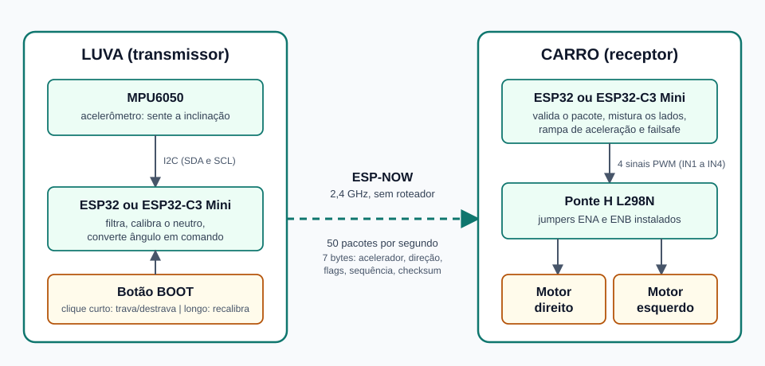
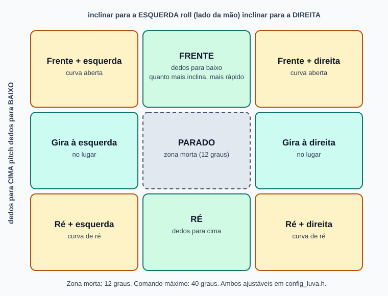
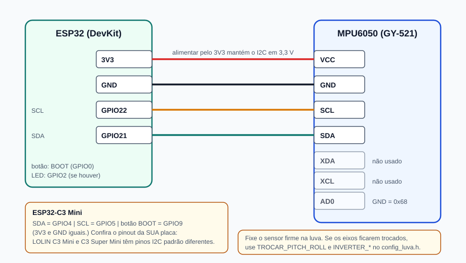
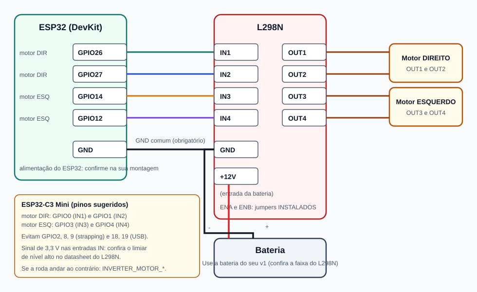

# ESP HAND CONTROL 2.0 — Manual do Tio Rafa

Uma luva que lê a inclinação da sua mão e comanda um carrinho pelo ar, sem roteador, sem celular, sem internet. Duas placas ESP32, um sensor e uma ponte H. Neste manual você monta, programa, testa, ajusta e ainda discute com seus colegas o que significa "controlar uma coisa com a mão".

**Versão do firmware:** 2.0.0
**Placas suportadas:** ESP32 clássico (DevKit) e ESP32-C3 Mini (LOLIN C3 Mini e C3 Super Mini)
**Ambiente:** Arduino IDE, pacote "esp32 by Espressif Systems" (core 2.x ou 3.x)

---

## Aviso de honestidade técnica

Leia isto antes de qualquer coisa. Faz parte do jeito Tio Rafa de trabalhar: dizer o que foi verificado e o que não foi.

| Etapa | Situação |
|---|---|
| Revisão do código e da lógica | VALIDADO POR ANÁLISE |
| Testes automáticos no computador (lógica, protocolo, comportamento do carro e da luva, 2 placas x 2 versões do core, com simulação das bibliotecas do ESP32) | VALIDADO POR ANÁLISE (rodou e passou) |
| Compilação com o core Arduino-ESP32 real e gravação em placas | Feitas pelo autor do projeto (Rafael Oliveira), nas suas placas |
| Funcionamento em placas reais | TESTADO EM HARDWARE pelo autor (Rafael Oliveira, informado em 04/11/2026) |

Na prática: o código foi conferido por análise e por simulação no computador, e o autor do projeto testou a luva e o carro em hardware real e informou que funcionam. Detalhe: o autor informa que o projeto foi testado e funciona; os resultados linha a linha não foram enviados ao pacote, então a matriz do manual segue em branco para a sua turma registrar o que observar. A sua montagem pode ter diferenças: preencha a tabela de testes (seção 12) e, se algo não compilar ou divergir, abra uma issue no GitHub com a mensagem de erro.

Informações que dependem da sua placa específica estão marcadas como **CONFIRME NA SUA PLACA**. Não invente pino: confira o esquema.

---

## Sumário

1. O que você vai construir
2. O que mudou da versão 1 para a 2
3. Interlúdio filosófico: a mão e a ferramenta
4. Como funciona (arquitetura)
5. Lista de materiais
6. Escolhendo a placa e preparando a Arduino IDE
7. Montagem e ligações
8. Os cinco passos (do mais simples ao projeto completo)
9. Ajustando o comportamento
10. Passeio pelo código
11. Segurança
12. Testes e tabela de resultados
13. Diagnóstico de problemas
14. Desafios para a turma
15. Interlúdios filosóficos adicionais
16. Referências e créditos

---

## 1. O que você vai construir

Dois aparelhos que conversam entre si:

- **A luva (transmissor):** uma ESP32 com um sensor MPU6050 preso à mão. Quando você inclina a mão, o sensor percebe a direção da gravidade e a luva traduz o ângulo em dois números: quanto acelerar e quanto virar.
- **O carro (receptor):** uma ESP32 ligada a uma ponte H L298N e a dois motores. Ele recebe os dois números pelo ar e move as rodas.

A conversa usa o **ESP-NOW**, um protocolo da Espressif que deixa duas placas ESP32 trocarem pacotes pequenos diretamente, sem passar por roteador. É rápido, simples e perfeito para sala de aula, onde o Wi-Fi da escola nem sempre colabora.

Resultado esperado no final do projeto:

1. Você liga o carro. Ele fica parado e mostra no Monitor Serial que está esperando a luva.
2. Você liga a luva, mantém a mão na posição neutra e a calibração acontece.
3. Você destrava a luva com um clique no botão.
4. Dedos para baixo: o carro vai para frente. Dedos para cima: ré. Mão inclinada para os lados: o carro vira.
5. Mão na posição neutra (dentro da zona morta): o carro para.
6. Se você travar a luva, desligá-la ou sair do alcance: o carro para sozinho.



---

## 2. O que mudou da versão 1 para a 2

A versão 1 funcionou e ensinou muita coisa. Revisando o código, encontrei pontos que valem melhorar. Nada disso é crítica: é o ciclo normal de quem constrói.

| Assunto | Versão 1 | Versão 2 |
|---|---|---|
| Placas | ESP32 clássico | ESP32 clássico e ESP32-C3 Mini, com os pinos escolhidos automaticamente |
| Core Arduino-ESP32 | Funciona só no 2.x (PWM e callback de recepção mudaram no 3.x) | Funciona no 2.x e no 3.x, detectando a versão em tempo de compilação |
| Sensor | Biblioteca com DMP (processamento interno do chip), sujeita a deriva no giro | Leitura direta do acelerômetro com filtro: sem deriva, sem biblioteca extra |
| Pacote de rádio | 3 bytes crus, sem validação | 7 bytes com marcador, versão, sequência e checksum; pacote inválido é descartado |
| Segurança | Dependia do último comando recebido | Failsafe: sem pacote válido por 400 ms, os motores param |
| Luva travada | Não existia | Começa travada; botão trava/destrava; luva travada para o carro na hora |
| Calibração | Fixa no código | Recalibra o neutro com pressão longa no botão |
| Velocidade | Liga/desliga | Proporcional ao ângulo (ou liga/desliga, se você quiser) |
| Motores | Índices de motor fora dos limites da lista e PWM anexado ao GPIO0 | Classe própria de ponte H, só dois motores, pinos de saída seguros |
| Curva | Nomes herdados de carro mecanum, deixando esquerda/direita ambíguas em 2 motores | Mistura diferencial ("tanque") clara e testada |
| Rampa | Não existia | Aceleração suave, evita tranco e queda de tensão |
| MAC do carro | Escrito direto no código | Constante única em `config_luva.h`; a luva se recusa a iniciar se você esquecer de configurar |
| Recepção | Trabalho de motor dentro do callback do rádio | Callback só guarda o dado; o `loop()` faz o resto |
| Documentação | PDF | Este manual, README, diagnóstico, protocolo, pinagem e referências |

---

## 3. Interlúdio filosófico: a mão e a ferramenta

Antes de ligar um fio, uma pergunta: **o que é uma mão?**

Aristóteles, no tratado *Sobre a Alma* (livro III, capítulo 8), chamou a mão de "ferramenta das ferramentas": a mão não faz uma tarefa só, ela é o que nos permite fazer qualquer ferramenta. Com este projeto, a mão ganha uma camada a mais. Ela deixa de apenas empurrar o carro e passa a **conversar** com ele, à distância.

O fenomenólogo Maurice Merleau-Ponty (*Fenomenologia da Percepção*) usou o exemplo da bengala de quem não enxerga. Depois de algum tempo, a pessoa não "sente a bengala": sente o chão, na ponta dela. A ferramenta é incorporada ao corpo. Quando você pratica com a luva e para de pensar em "inclinar 25 graus" e começa a pensar apenas em "ir ali", algo parecido aconteceu: o carro virou uma extensão do seu gesto.

Martin Heidegger descreveu essa mesma experiência em *Ser e Tempo* (parágrafos 15 a 18): a ferramenta que funciona bem some da nossa atenção; só a notamos quando quebra. Guarde essa imagem. Quando o carro não obedece, você de repente **vê** o sensor, o rádio, o ângulo, a bateria. Depurar é a arte de enxergar o que estava invisível.

> Para discutir em grupo: em que momento o carro deixa de ser "aquilo que eu estou controlando" e passa a ser "o meu movimento"? O que acontece com essa sensação quando há atraso (latência) entre o gesto e a resposta?

---

## 4. Como funciona (arquitetura)

### 4.1 Da inclinação ao comando

O MPU6050 tem um acelerômetro. Parado, ele mede a gravidade, e a direção da gravidade em relação ao sensor revela o quanto a mão está inclinada. A luva calcula dois ângulos:

- **pitch:** inclinação para frente e para trás (dedos para baixo ou para cima);
- **roll:** inclinação para os lados.

O acelerômetro não mede giro em torno do eixo vertical (guinada), e por isso não há deriva: a gravidade é uma referência que não se acumula em erro.

Como a mão treme, os ângulos passam por um **filtro de média exponencial** (`FILTRO_ALFA`). Depois, cada ângulo é convertido em um percentual de -100 a +100 por uma **zona morta** (`ZONA_MORTA_GRAUS`): dentro dela, o valor é zero. A partir da zona morta até `ANGULO_MAXIMO_GRAUS`, o comando cresce de forma proporcional.



### 4.2 Mistura diferencial

O carro tem duas rodas motrizes, uma de cada lado. Para virar, as rodas giram em velocidades diferentes. Com `acelerador` e `direção` entre -1 e +1:

```text
esquerda = acelerador + direção
direita  = acelerador - direção
```

Se o maior valor passar de 1, os dois são divididos por ele, mantendo a proporção. Assim, acelerar tudo e virar tudo ao mesmo tempo não "estoura" o comando: o carro faz uma curva fechada em vez de ficar travado.

### 4.3 O pacote

A luva envia 50 pacotes por segundo. Cada pacote tem 7 bytes:

| Byte | Campo | Para que serve |
|---:|---|---|
| 0 | magic | Marcador (0xA7). Descarta lixo de outras redes |
| 1 | versão | Versão do protocolo (2). Evita misturar firmwares incompatíveis |
| 2 | sequência | Contador. O carro conta quantos pacotes se perderam |
| 3 | acelerador | De -100 a +100 |
| 4 | direção | De -100 a +100 |
| 5 | flags | Bit 0 = luva habilitada |
| 6 | checksum | XOR dos 6 bytes anteriores, para detectar corrupção |

Detalhes completos em [PROTOCOLO.md](PROTOCOLO.md).

### 4.4 Segurança por projeto

O carro só anda se **todas** estas condições forem verdadeiras ao mesmo tempo:

1. o pacote é válido (marcador, versão, checksum e faixa);
2. a luva está destravada (flag habilitado);
3. o último pacote válido chegou há menos de 400 ms.

Qualquer falha leva a motores parados (estado SEM SINAL ou TRAVADO). Além disso, a velocidade muda por rampa (`PASSO_RAMPA`), exceto na parada de segurança, que é imediata.

### 4.5 Sobre criptografia

O ESP-NOW permite cifrar a comunicação entre pares conhecidos (chaves PMK e LMK). Este projeto **não ativa** a criptografia por padrão, para manter o primeiro contato simples. Na versão 1, o PDF dizia que havia criptografia padrão; isso não procede para o modo usado aqui, e fica a correção registrada. Ativar a criptografia é o Desafio 1 da seção 14.

---

## 5. Lista de materiais

**Kit pronto:** [Kit Projeto Esp-Hand Control - Prof. Rafael Oliveira](https://www.mamuteeletronica.com.br/kit-projeto-esp-hand-control-prof-rafael-oliveira-21010), na Mamute Eletrônica. O que vem dentro do kit é **INFORMAÇÃO NÃO CONFIRMADA** aqui: confira na página da loja. Sem o kit, monte com a lista abaixo e peças recicladas. Confira com a lista do seu kit da versão 1. Valores de tensão e corrente dependem dos seus motores e da sua bateria: **CONFIRME NA SUA MONTAGEM**.

**Luva**

| Qtd | Item | Observação |
|---:|---|---|
| 1 | ESP32 DevKit **ou** ESP32-C3 Mini | Veja a seção 6 |
| 1 | Módulo MPU6050 (GY-521) | Acelerômetro e giroscópio |
| 4 | Fios jumper | 3V3, GND, SDA, SCL |
| 1 | Fonte portátil | Power bank ou bateria com regulador adequado à sua placa |
| 1 | Luva ou tira de velcro | Para fixar o conjunto com firmeza na mão |

**Carro**

| Qtd | Item | Observação |
|---:|---|---|
| 1 | ESP32 DevKit **ou** ESP32-C3 Mini | Veja a seção 6 |
| 1 | Ponte H L298N | Com jumpers ENA e ENB instalados |
| 2 | Motores DC com rodas (caixa de redução) | Do kit do projeto |
| 1 | Chassi com roda boba | Qualquer chassi de dois motores |
| 1 | Bateria para os motores | Compatível com os motores e com o L298N |
| 1 | Chave liga/desliga | Para cortar a bateria |
| - | Fios jumper e fios mais grossos para os motores | |

A lista de materiais em formato de tabela para impressão está em [hardware/LISTA_DE_MATERIAIS.md](../hardware/LISTA_DE_MATERIAIS.md).

---

## 6. Escolhendo a placa e preparando a Arduino IDE

### 6.1 "ESP32" não é uma coisa só

Este é o princípio número um do nosso padrão: **ESP32 é uma família**. O ESP32 clássico, o ESP32-S3 e o ESP32-C3 têm pinos, periféricos e comportamentos de boot diferentes. Por isso, o firmware escolhe os pinos pelo chip detectado (`CONFIG_IDF_TARGET_ESP32` ou `CONFIG_IDF_TARGET_ESP32C3`). Se você usar outro chip, o código para de compilar com uma mensagem pedindo que você mapeie os pinos: de propósito. Melhor um erro de compilação do que um robô com pino errado.

### 6.2 Instalando o pacote ESP32

Na Arduino IDE:

1. Arquivo, Preferências.
2. Em "URLs adicionais para Gerenciador de Placas", adicione:
   `https://espressif.github.io/arduino-esp32/package_esp32_index.json`
3. Ferramentas, Placa, Gerenciador de Placas.
4. Pesquise `esp32` e instale **esp32 by Espressif Systems**.

O código funciona com as séries 2.x e 3.x do pacote. Anote a versão que você instalou na tabela de testes.

### 6.3 Qual placa selecionar na IDE

| Sua placa | Seleção sugerida | Situação |
|---|---|---|
| ESP32 DevKit clássico | ESP32 Dev Module | CONFIRME NA SUA PLACA |
| LOLIN C3 Mini | entrada "LOLIN C3 Mini", se existir na sua versão do core; senão "ESP32C3 Dev Module" | CONFIRME NA SUA PLACA |
| C3 Super Mini | "ESP32C3 Dev Module" (ou entrada própria, se existir) | CONFIRME NA SUA PLACA |

### 6.4 Detalhes que pegam muita gente na C3

- **USB CDC On Boot:** nas placas C3 Mini, a USB é do próprio chip. Para o `Serial` aparecer no Monitor Serial, ative **Ferramentas, USB CDC On Boot, Enabled**. Sem isso, o gravador funciona, mas o Monitor fica mudo.
- **Pinos de boot (strapping):** GPIO2, GPIO8 e GPIO9 influenciam como a placa liga. O firmware evita usá-los como saída de motor. O GPIO9 é usado apenas como botão, com a placa já ligada.
- **Potência de transmissão:** algumas C3 Super Mini têm problema de sinal fraco que melhora reduzindo a potência de transmissão. O firmware já aplica `WIFI_POWER_8_5dBm` nas C3 (`TX_POWER_PERSONALIZADO`). Se sua placa funcionar bem sem isso, você pode remover.
- **I2C padrão difere entre fabricantes:** na LOLIN C3 Mini o I2C padrão usa GPIO8 e GPIO10; na Super Mini, GPIO8 e GPIO9. Para evitar conflito com as duas, o projeto usa **SDA = GPIO4 e SCL = GPIO5**. CONFIRME NA SUA PLACA se esses pinos estão expostos nos seus furos.
- **Sem USB conectada:** o código usa `Serial.setTxTimeoutMs(0)` para o programa não travar quando você roda a luva na bateria, sem computador.

### 6.5 Estrutura de pastas

Cada passo é uma pasta de sketch independente (a Arduino IDE exige que o nome da pasta seja igual ao do `.ino`). Os arquivos `.h` compartilhados vivem em `firmware/comum/` e são **copiados** para as pastas dos sketches pelo script `tools/sincronizar_comum.sh`. Isso é proposital: a Arduino IDE só enxerga arquivos dentro da pasta do sketch. Se você editar um arquivo em `comum/`, rode o script de novo (ou edite direto na pasta do sketch que está usando, ciente de que as cópias podem divergir; `sincronizar_comum.sh --checar` avisa).

---

## 7. Montagem e ligações

### 7.1 A luva



| MPU6050 | ESP32 clássico | ESP32-C3 Mini |
|---|---|---|
| VCC | 3V3 | 3V3 |
| GND | GND | GND |
| SCL | GPIO22 | GPIO5 |
| SDA | GPIO21 | GPIO4 |
| AD0 | GND (endereço 0x68) | GND (endereço 0x68) |

Botão: o próprio botão BOOT da placa (GPIO0 no clássico, GPIO9 na C3), ativo em nível baixo. LED: GPIO2 no clássico, se a sua placa tiver.

Alimente o módulo pelo **3V3** do ESP32: assim os sinais I2C ficam em 3,3 V, que é o nível lógico do ESP32. Nunca assuma que um módulo "que funciona no Arduino Uno" aceita 3,3 V ou 5 V sem conferir.

Fixe o sensor firme na luva, pois ele precisa se mover junto com a mão. Se os eixos ficarem trocados ou invertidos, não mexa no fio: ajuste `TROCAR_PITCH_ROLL`, `INVERTER_ACELERADOR` e `INVERTER_DIRECAO` em `config_luva.h`.

### 7.2 O carro



| L298N | ESP32 clássico | ESP32-C3 Mini | Função |
|---|---|---|---|
| IN1 | GPIO26 | GPIO0 | Motor direito, sentido A |
| IN2 | GPIO27 | GPIO1 | Motor direito, sentido B |
| IN3 | GPIO14 | GPIO3 | Motor esquerdo, sentido A |
| IN4 | GPIO12 | GPIO4 | Motor esquerdo, sentido B |
| GND | GND | GND | Terra comum, obrigatório |

Observações importantes:

- **ENA e ENB:** mantenha os jumpers instalados. O PWM de velocidade é aplicado diretamente nos pinos IN, e os jumpers deixam as pontes sempre habilitadas.
- **Terra comum:** o GND do ESP32, o GND do L298N e o negativo da bateria precisam estar interligados. Sem isso o sinal não tem referência e o comportamento é aleatório.
- **Motores nunca em GPIO:** os motores ligam nas saídas OUT1 a OUT4 do L298N, jamais direto no ESP32.
- **GPIO12 no ESP32 clássico** é um pino de boot (MTDI): em algumas placas, um nível alto nele na hora de ligar impede o boot. Como aqui ele é saída do firmware e começa em nível baixo, normalmente funciona; se sua placa não ligar com o L298N conectado, desconecte o fio do GPIO12 para ligar e teste trocar por outro pino livre em `config_carro.h`. CONFIRME NA SUA PLACA.
- **Alimentação do ESP32 do carro:** use uma forma segura e compatível com a sua placa (USB/power bank, ou regulador adequado). O manual não afirma uma ligação específica, porque ela depende da sua montagem e da faixa de tensão do L298N e do regulador da placa. CONFIRME NA SUA MONTAGEM.
- **Nível lógico:** o ESP32 entrega 3,3 V nas saídas. Confira no datasheet do L298N o nível mínimo de entrada para "alto". Se o seu módulo não acionar de forma confiável, use um conversor de nível ou um driver compatível com 3,3 V.

### 7.3 Descobrindo qual lado é qual

O código chama de "direito" o motor ligado a OUT1/OUT2 e de "esquerdo" o ligado a OUT3/OUT4. Na prática, o que importa é como **você** montou o carro. Se, ao mandar virar à direita, o carro virar à esquerda, ou uma roda girar ao contrário, use `INVERTER_MOTOR_ESQ` e `INVERTER_MOTOR_DIR` (para o sentido de giro de cada roda) ou troque os fios. O Passo 3 serve exatamente para isso.

---

## 8. Os cinco passos

Regra de ouro do projeto: **teste cada peça sozinha antes de juntar tudo**. Um componente funcionando isolado não garante o sistema completo, mas um componente quebrado garante que o sistema não funciona.

Em todos os passos: selecione a placa e a porta corretas, abra o Monitor Serial a **115200** e, na C3, ative o USB CDC On Boot.

### Passo 1: descobrir o endereço MAC do carro

Pasta: `firmware/Passo1_Descobrir_MAC`

Cada ESP32 tem um endereço MAC único. A luva precisa dele para saber para quem enviar.

1. Grave o sketch na placa que será o **carro**.
2. Abra o Monitor Serial.
3. Anote a linha em formato de lista C, por exemplo `{0x24, 0x6F, 0x28, 0xAA, 0xBB, 0xCC}`.

Resultado esperado: a cada 2 segundos o MAC aparece em texto e em formato de vetor C. Sempre que você trocar a placa do carro, repita este passo.

### Passo 2: testar o sensor MPU6050

Pasta: `firmware/Passo2_Teste_MPU6050`

1. Ligue o sensor à placa da **luva** conforme a seção 7.1.
2. Grave o sketch e abra o Monitor Serial.
3. Incline a mão em todas as direções.

Resultado esperado: o identificador (WHO_AM_I) do sensor é lido, e pitch e roll mudam suavemente conforme você inclina. Se o sensor não for encontrado, o sketch faz uma varredura I2C e lista os endereços que respondem: se aparecer 0x69, o pino AD0 está em nível alto; se não aparecer nada, revise fios e alimentação. Para ver os ângulos em gráfico, ative `MODO_PLOTTER` no sketch e abra o Serial Plotter.

### Passo 3: testar os motores

Pasta: `firmware/Passo3_Teste_Motores`

1. **Tire o carro do chão** (rodas no ar) ou apoie-o em um suporte.
2. Grave o sketch na placa do **carro** e ligue a bateria.
3. Há uma contagem regressiva de 5 segundos antes do primeiro movimento.

O teste percorre: cada motor para frente e para trás, os dois para frente, giro para a direita, giro para a esquerda e uma rampa de PWM para você descobrir a partir de qual valor o motor realmente começa a girar.

Resultado esperado: cada roda gira no sentido anunciado no Monitor Serial. Se uma roda girar ao contrário, ajuste `INVERTER_MOTOR_ESQ` ou `INVERTER_MOTOR_DIR`. Anote o valor em que o motor começa a girar e use em `PWM_MINIMO`.

Este é o único sketch que usa `delay()` de propósito: por ser uma sequência didática, a clareza vale mais que a concorrência.

### Passo 4: o carro receptor

Pasta: `firmware/Passo4_Carro_Receptor`

1. Grave na placa do carro.
2. O Monitor Serial mostra o MAC do carro, o canal ESP-NOW e o estado.

Resultado esperado, antes de existir luva: estado SEM SINAL, motores parados, mensagens de diagnóstico no Monitor Serial.

Os três estados do carro:

| Estado | Quando | LED (se houver) |
|---|---|---|
| SEM SINAL | Nenhum pacote válido recente | Pisca rápido |
| TRAVADO | Pacotes válidos chegando, mas a luva está travada | Pisca lento |
| ATIVO | Pacotes válidos e luva destravada | Aceso fixo |

Só no estado ATIVO os motores recebem comando.

---

### Passo 5: a luva transmissora

Pasta: `firmware/Passo5_Luva_Transmissor`

1. Abra `config_luva.h` e troque `MAC_CARRO` pelo MAC anotado no Passo 1. Enquanto estiver com zeros, a luva **se recusa a iniciar** e avisa o motivo. É proposital.
2. Grave na placa da luva.
3. Coloque a mão na posição neutra e mantenha parada durante a calibração (cerca de 1,5 s). Se mexer demais, ela pede para tentar de novo, até 5 vezes.
4. Controles do botão:
   - clique curto: trava e destrava (a luva **inicia travada**);
   - pressão longa (1,5 s): recalibra a posição neutra.
5. Destrave, incline a mão e acompanhe o carro.

Resultado esperado: com a luva travada, o carro fica parado mesmo que você incline a mão. Destravada, o carro obedece. Ao travar de novo, ele para na hora, sem rampa.

---

## 9. Ajustando o comportamento

Todos os ajustes ficam em dois arquivos, comentados linha a linha.

**`config_luva.h`**

| Parâmetro | Padrão | Quando mexer |
|---|---:|---|
| `ZONA_MORTA_GRAUS` | 12 | Mão tremida ou carro "andando sozinho": aumente |
| `ANGULO_MAXIMO_GRAUS` | 40 | Quer velocidade máxima com menos inclinação: diminua |
| `MODO_PROPORCIONAL` | true | `false` imita o liga/desliga da v1 |
| `TROCAR_PITCH_ROLL` | false | Sensor girado 90 graus na luva |
| `INVERTER_ACELERADOR` | false | Dedos para baixo faz o carro dar ré |
| `INVERTER_DIRECAO` | false | Inclinar à direita vira à esquerda |
| `FILTRO_ALFA` | 0.25 | Menor = mais suave e mais lento; maior = mais rápido e mais tremido |
| `PERIODO_ENVIO_MS` | 20 | 50 pacotes por segundo |
| `INICIAR_TRAVADA` | true | Segurança na sala de aula: deixe ligado |
| `BOTAO_PRESSAO_LONGA_MS` | 1500 | Tempo para recalibrar |

**`config_carro.h`**

| Parâmetro | Padrão | Quando mexer |
|---|---:|---|
| `INVERTER_MOTOR_ESQ/DIR` | false | Roda girando ao contrário |
| `PWM_MINIMO` | 80 | Motor "zumbe" sem girar: aumente (descubra no Passo 3) |
| `LIMITE_VELOCIDADE_PCT` | 100 | Sala pequena ou iniciantes: use 60 |
| `PASSO_RAMPA` | 0.10 | 0,10 significa de 0 a 100% em 0,2 s; menor = mais suave |
| `TIMEOUT_SINAL_MS` | 400 | Tempo sem pacote válido até parar |
| `FILTRAR_REMETENTE` | 0 | Coloque 1 e defina `MAC_LUVA_PERMITIDA` para aceitar só a sua luva |

Várias duplas na mesma sala: o canal ESP-NOW é definido em `protocolo.h` (`CANAL_ESPNOW`). Com vários carros e luvas no mesmo canal, ative `FILTRAR_REMETENTE` em cada carro e informe o MAC da luva correspondente.

---

## 10. Passeio pelo código

```text
firmware/
├── comum/                      arquivos compartilhados (fonte oficial)
│   ├── protocolo.h             formato do pacote e validação
│   ├── logica.h                funções puras: ângulo, zona morta, mistura, rampa
│   ├── mpu6050.h               driver mínimo do sensor
│   ├── motores.h               PWM compatível com core 2.x/3.x e classe da ponte H
│   ├── utilitarios.h           Serial seguro, LED, pisca-pisca sem delay
│   ├── config_carro.h          pinos e parâmetros do carro
│   └── config_luva.h           pinos e parâmetros da luva
├── Passo1_Descobrir_MAC/
├── Passo2_Teste_MPU6050/
├── Passo3_Teste_Motores/
├── Passo4_Carro_Receptor/
└── Passo5_Luva_Transmissor/
```

Ideias de design que valem a leitura:

- **Funções puras em `logica.h`.** Quem calcula ângulo, zona morta, mistura e rampa não conhece pinos nem rádio. Por isso a matemática pôde ser testada no computador, sem placa.
- **Hardware separado da lógica.** Pinos ficam nos `config_*.h`; o resto do código fala em "motor esquerdo", não em "GPIO14".
- **Sem `delay()` no fluxo principal.** O `loop()` usa `millis()` para decidir quando enviar, ler e atualizar motores, e assim o rádio, o sensor e os motores convivem.
- **Callback curto.** A função que o ESP-NOW chama ao receber um pacote só valida e guarda o dado sob proteção (`portMUX`). Quem age sobre o dado é o `loop()`. O callback roda na tarefa do Wi-Fi: nada de mexer em motor lá dentro.
- **Compatibilidade de core.** `ESP_ARDUINO_VERSION_MAJOR` escolhe a API de PWM e a assinatura do callback de recepção. Dois blocos pequenos, bem comentados.
- **Estado seguro na inicialização.** Pinos dos motores são colocados em nível baixo antes de configurar o PWM.

---

## 11. Segurança

1. **Primeiro teste com as rodas no ar.** Sempre.
2. **Luva inicia travada.** Mantenha `INICIAR_TRAVADA = true` em sala de aula.
3. **Failsafe de 400 ms.** Não aumente sem uma boa razão.
4. **Bateria:** use a bateria correta para o seu L298N e seus motores, com chave geral e, se possível, proteção. Baterias de lítio exigem cuidado com curto-circuito, inversão de polaridade e carga.
5. **Terra comum** em todo o carro.
6. **Quedas de tensão:** motores geram ruído e quedas que podem resetar o ESP32. Se o comportamento parecer aleatório, **verifique a alimentação antes de mexer no código** (veja a seção 13).
7. **Espaço:** teste longe de bordas de mesa, de pessoas e de animais. O carro deve parar quando você soltar o gesto, mas confirme isso antes de acelerar.
8. **Supervisão:** com crianças, sempre com um adulto, e sempre com `LIMITE_VELOCIDADE_PCT` reduzido.

---

## 12. Testes e tabela de resultados

### 12.1 O que já foi verificado no computador

O repositório inclui uma suíte em `tools/teste_host/`. Ela compila os sketches reais do carro e da luva contra versões simuladas do `Arduino.h`, `Wire`, `WiFi` e `esp_now`, nas duas versões da API do core (2.x e 3.x) e nos dois chips (ESP32 e ESP32-C3), e verifica, entre outras coisas:

- cálculo de inclinação, zona morta, mistura diferencial, rampa e PWM mínimo;
- pacote: marcador, versão, checksum, faixas e rejeição de pacotes adulterados;
- carro: para sem sinal, para com luva travada, para com pacote inválido, conta pacotes perdidos;
- luva: se recusa a iniciar sem MAC, calibra, trava e destrava, recupera de falha do sensor.

Para rodar: `bash tools/teste_host/rodar_testes.sh` (precisa de `g++`).

Foi feito também um **teste de mutação**: inverti de propósito o sinal da direção no código e a suíte falhou, e ao restaurar voltou a passar. Isso mostra que os testes realmente detectam erros.

**Limite desta evidência:** simulação não é o core real. Ela garante a lógica e a sintaxe da nossa parte, não o comportamento do rádio, da USB, da fiação nem dos motores.

### 12.2 Sua tabela de hardware

Preencha a coluna "Resultado real" depois de testar. Deixe em branco o que não testou.

| Nº | Teste | Ação | Resultado esperado | Resultado real |
|---:|---|---|---|---|
| 01 | Compilação do Passo 1 | Verificar | Compila sem erros | |
| 02 | Compilação dos Passos 2 a 5 | Verificar | Compila sem erros | |
| 03 | Passo 1 | Gravar no carro | MAC impresso a cada 2 s | |
| 04 | Passo 2 | Incline a mão | Pitch e roll variam suavemente | |
| 05 | Passo 2 | Desconectar SDA | Mensagem de erro e varredura I2C | |
| 06 | Passo 3 | Rodas no ar | Cada roda gira no sentido anunciado | |
| 07 | Passo 3 | Rampa de PWM | Identificado o PWM mínimo | |
| 08 | Passo 4 | Sem luva | Estado SEM SINAL, motores parados | |
| 09 | Passo 5 | MAC com zeros | Luva se recusa a iniciar | |
| 10 | Passo 5 | MAC correto, calibração | Calibração concluída | |
| 11 | Integração | Luva travada | Carro não anda | |
| 12 | Integração | Destravar, dedos para baixo | Carro anda para frente | |
| 13 | Integração | Dedos para cima | Carro dá ré | |
| 14 | Integração | Inclinar à direita | Carro vira à direita | |
| 15 | Integração | Mão neutra | Carro para | |
| 16 | Failsafe | Desligar a luva andando | Carro para em cerca de 0,4 s | |
| 17 | Failsafe | Travar a luva andando | Carro para na hora | |
| 18 | Alcance | Afastar a luva | Anote a distância até o carro parar | |
| 19 | C3 Mini | Repetir 03, 08, 10, 12 | Mesmos resultados do ESP32 clássico | |
| 20 | Alimentação | Acelerar com bateria | Sem resets do ESP32 | |

### 12.3 Lista de integração

```text
[ ] placa certa selecionada, core instalado (anote a versão)
[ ] GND comum confirmado
[ ] sensor testado sozinho
[ ] motores testados sozinhos (rodas no ar)
[ ] MAC do carro configurado na luva
[ ] failsafe testado
[ ] luva travada testada
[ ] comportamento final conferido com o resultado esperado
```

---

## 13. Diagnóstico de problemas

Siga **esta ordem**. Em robótica, o defeito costuma morar nas camadas de baixo, e reescrever código é a última coisa a fazer.

```text
USB -> porta serial -> placa selecionada -> core -> bibliotecas
-> compilação -> upload -> reset -> inicialização -> GPIO
-> alimentação -> periférico -> lógica do programa
```

| Sintoma | Causas prováveis | O que fazer |
|---|---|---|
| Porta não aparece | Cabo só de carga, driver, porta USB ruim | Troque o cabo (use um de dados), outra porta |
| Upload falha no clássico | Placa pede BOOT pressionado | Segure BOOT durante o "Connecting..." |
| Upload falha na C3 | Placa fora do modo de gravação | Segure BOOT, toque RESET, solte BOOT |
| Monitor Serial vazio na C3 | USB CDC On Boot desligado | Ferramentas, USB CDC On Boot, Enabled |
| Erro de compilação sobre PWM ou callback | Versão do core | Informe a versão do core; o código trata 2.x e 3.x |
| Erro "Placa ainda nao mapeada" | Chip diferente de ESP32 e C3 | Mapeie os pinos nos `config_*.h` consultando o esquema da placa |
| Luva "recusa iniciar" | `MAC_CARRO` com zeros | Rode o Passo 1 e copie o MAC |
| Sensor não encontrado | Fios, AD0, alimentação | Veja a varredura I2C do Passo 2 |
| Ângulos trocados ou invertidos | Sensor girado na luva | `TROCAR_PITCH_ROLL`, `INVERTER_*` |
| Carro anda sozinho | Zona morta pequena, neutro mal calibrado | Aumente `ZONA_MORTA_GRAUS`, recalibre (pressão longa) |
| Carro não anda, mas Serial mostra pacotes | Luva travada, `PWM_MINIMO` baixo, bateria fraca | Destrave; aumente `PWM_MINIMO`; troque a bateria |
| Carro para e volta, "soluça" | Perda de pacotes, alimentação | Aproxime as placas; verifique alimentação |
| Reset do ESP32 ao acelerar | Queda de tensão dos motores | Alimentação e fios mais grossos; capacitores; tensão correta |
| Uma roda gira ao contrário | Fiação ou montagem | `INVERTER_MOTOR_*` |
| Não recebe nada | Canal, MAC errado, versão de protocolo diferente | Reconfira `MAC_CARRO`; mesmo `CANAL_ESPNOW` e `PROTOCOLO_VERSAO` nos dois |
| Alcance curto na C3 | Antena da placa | Ajuste `TX_POWER_PERSONALIZADO`; afaste de metal e do corpo |

Duas ferramentas de diagnóstico embutidas: o Monitor Serial da luva mostra pitch, roll, comando e estado; o do carro mostra o estado, o comando recebido, os pacotes válidos, inválidos e perdidos. Ajuste `DEBUG_INTERVALO_MS` ou desligue `DEBUG_SERIAL` quando terminar.

---

## 14. Desafios para a turma

1. **Criptografia.** Pesquise PMK e LMK no ESP-NOW e faça a luva e o carro se comunicarem de forma cifrada. O que muda no registro dos pares?
2. **Vários carros, uma luva.** Como a luva escolheria o destino? Botão para alternar? Broadcast?
3. **Telemetria de volta.** O carro devolve a tensão da bateria e a luva avisa quando estiver baixa.
4. **Sensor de dedos.** Acrescente um sensor flex em um dedo para controlar uma garra ou um limitador de velocidade.
5. **Estatística de rádio.** Meça pacotes perdidos por distância e faça um gráfico. Existe uma "borda" onde a comunicação cai de repente?
6. **Dois modos.** Alterne entre proporcional e liga/desliga com um duplo clique. Qual dá mais controle a um iniciante? E a um especialista?
7. **Outra mão.** Torne o projeto utilizável por canhotos e por quem tem pouco movimento em um dos pulsos. Que parâmetros precisam existir para isso?
8. **Acessibilidade.** O que muda se o controle for pelo cotovelo, pelo pé ou pela cabeça? O que a inclinação continua medindo?

---

## 15. Interlúdios filosóficos adicionais

### 15.1 Cibernética: o piloto e o leme

Norbert Wiener batizou de **cibernética** (1948) o estudo do controle e da comunicação em animais e máquinas, a partir da palavra grega *kybernetes*, o timoneiro de um barco. O timoneiro olha o rumo, corrige o leme, olha de novo: isso é **realimentação**.

Seu projeto tem um laço de realimentação, e quem o fecha é você. A luva manda, o carro anda, seus olhos veem, sua mão corrige. A máquina sozinha não fecha o laço; **o humano é parte do circuito**. Agora imagine o contrário: um carro com sensor de distância que desvia sozinho. Quem é o timoneiro?

### 15.2 A mente estendida

Andy Clark e David Chalmers propuseram (*The Extended Mind*, 1998) que, em certas condições, ferramentas externas fazem parte do processo cognitivo, como o caderno de quem não consegue lembrar. A luva é um caso interessante: onde termina "você" e começa "o sistema"? Quando você deixa de olhar para a mão e passa a olhar só para o carro, a extensão funcionou.

### 15.3 A máquina aberta (Simondon)

Gilbert Simondon, em *Do modo de existência dos objetos técnicos* (1958), distingue objetos técnicos fechados, que escondem seu funcionamento e só se consomem, de **máquinas abertas**, que podem ser compreendidas, ajustadas e reconfiguradas por quem as usa. Ele defendia uma **cultura técnica**: entender o objeto técnico como parte da cultura, e não como um estranho a ela.

Este projeto tenta ser uma máquina aberta: o código é comentado, os pinos são nomeados, o protocolo é documentado, os parâmetros ficam à vista. Se você mudar `ZONA_MORTA_GRAUS` e perceber que o carro ficou mais "nervoso", já entendeu um princípio de Simondon na prática.

Para ler em português sobre o autor: VIANA (2020) sobre a mentalidade técnica e a intenção pedagógica em Simondon; DAMASCENO (2023) sobre a ideia de uma cultura tecno-estética.

### 15.4 Tecnodiversidade (Yuk Hui)

Yuk Hui, em *A questão da tecnologia na China* (2016) e em *Tecnodiversidade* (edição brasileira de 2020), sustenta que não existe "a" tecnologia universal e neutra: diferentes culturas relacionam-se com a técnica de modos diferentes (ele chama de cosmotécnicas). Para nós, que fazemos robótica em escola pública brasileira, a pergunta é incômoda e boa: **o que é um robô feito aqui, com os nossos materiais, o nosso orçamento e os nossos problemas?** Um kit "importado e fechado" ensina uma coisa; um projeto aberto, adaptado, consertado e reaproveitado ensina outra.

### 15.5 Autonomia: ensinar não é transferir

Paulo Freire, em *Pedagogia da Autonomia* (1996), afirma que ensinar exige criar as possibilidades para a produção ou a construção do conhecimento, e não simplesmente transmiti-lo. Seymour Papert, em *Mindstorms* (1980), defendeu o mesmo pelo caminho da tecnologia: a criança aprende melhor quando constrói coisas que lhe importam, e o computador é um material para pensar com.

Por isso este manual evita dar tudo pronto. Os cinco passos pedem que você observe, anote, ajuste e pergunte "por quê". A tabela de testes em branco não é descuido: é um convite. O papel de quem ensina aqui é o de companheiro de bancada, não de dono da resposta.

### 15.6 As leis, o limite e o domínio de si

Isaac Asimov imaginou em "Runaround" (1942) as Três Leis da Robótica, e passou a vida escrevendo histórias em que elas falham, justamente para mostrar que **regras simples encontram situações complexas**. Nosso carro tem uma "lei" bem mais modesta: *sem comando válido e recente, pare*. É um bom exemplo de **segurança por projeto**: em vez de confiar que tudo dará certo, projetamos o que acontece quando dá errado.

Epicteto, no *Encheirídion* (§1), separa o que depende de nós do que não depende. Num projeto de robótica, depende de nós o código, a fiação, os testes e o cuidado; não depende de nós a bateria que sulfata, o ruído no ar, o piso irregular. Um bom engenheiro projeta pensando no que **não** controla.

> Para discutir: se o carro atropelasse algo sem querer, de quem seria a responsabilidade: da luva, do código, de quem o programou, de quem o usou? O failsafe de 400 ms muda a resposta?

---

## 16. Referências e créditos

**Documentação técnica**

- Espressif. *Arduino-ESP32: documentação oficial.* https://docs.espressif.com/projects/arduino-esp32/
- Espressif. *ESP-NOW (ESP-IDF Programming Guide).* https://docs.espressif.com/projects/esp-idf/en/latest/esp32/api-reference/network/esp_now.html
- Pacote Arduino-ESP32 (URL do gerenciador de placas): https://espressif.github.io/arduino-esp32/package_esp32_index.json
- InvenSense. *MPU-6000 and MPU-6050 Register Map and Descriptions.* e *Product Specification* (datasheet do fabricante).
- STMicroelectronics. *L298 Dual Full-Bridge Driver* (datasheet).

Observação: confira cada link e cada datasheet antes de publicar; endereços mudam.

**Filosofia e educação**

- ARISTÓTELES. *Sobre a Alma* (De Anima), livro III, cap. 8.
- ASIMOV, I. "Runaround" (1942), republicado em *Eu, Robô* (1950).
- CLARK, A.; CHALMERS, D. The Extended Mind. *Analysis*, v. 58, n. 1, p. 7-19, 1998.
- DAMASCENO, V. Sobre a ideia de uma cultura Tecno-Estética em Gilbert Simondon. *Revista Interdisciplinar em Cultura e Sociedade*, São Luís, v. 9, n. 1, p. 1-12, jan./jun. 2023.
- EPICTETO. *Encheirídion (Manual)*, §1.
- FREIRE, P. *Pedagogia da Autonomia: saberes necessários à prática educativa.* São Paulo: Paz e Terra, 1996.
- HEIDEGGER, M. *Ser e Tempo*, §§ 15 a 18.
- HUI, Y. *The Question Concerning Technology in China: An Essay in Cosmotechnics.* Falmouth: Urbanomic, 2016.
- HUI, Y. *Tecnodiversidade.* São Paulo: Ubu Editora, 2020.
- MCLUHAN, M. *Understanding Media: The Extensions of Man.* 1964.
- MERLEAU-PONTY, M. *Fenomenologia da Percepção.*
- PAPERT, S. *Mindstorms: Children, Computers, and Powerful Ideas.* New York: Basic Books, 1980.
- SIMONDON, G. *Do modo de existência dos objetos técnicos.* Rio de Janeiro: Contraponto, 2020. Tradução de Vera Ribeiro. (Original: *Du mode d'existence des objets techniques*, 1958.)
- VIANA, D. Notas sobre a mentalidade técnica: a intenção pedagógica e a ênfase ativa na filosofia da técnica de Gilbert Simondon. *Revista Filosofia Unisinos*, v. 21, n. 1, p. 79-94, 2020.
- WIENER, N. *Cybernetics: or Control and Communication in the Animal and the Machine.* 1948.

**Créditos**

Projeto, conceito e kits: Prof. Tio Rafa (Rafael Oliveira), Robótica Paula Souza / CPS, com materiais da Mamute Eletrônica. Versão 2.0 reescrita e documentada com apoio de Claude (Anthropic), a ser testada em bancada pela comunidade.

Contato: contato@tiorafa.tec.br | Instagram: @prof.tiorafa | GitHub: Tio-Rafa-SE
